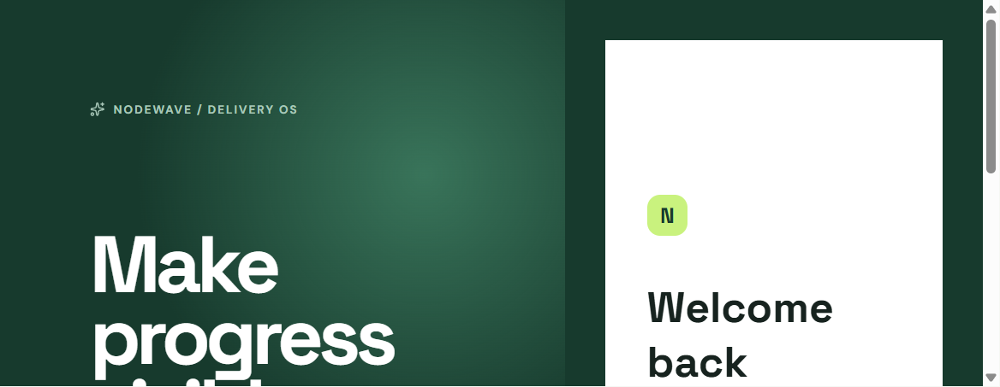
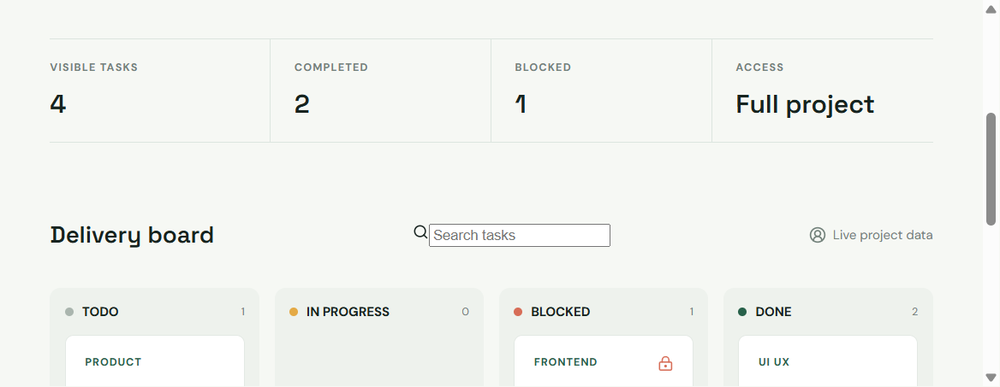
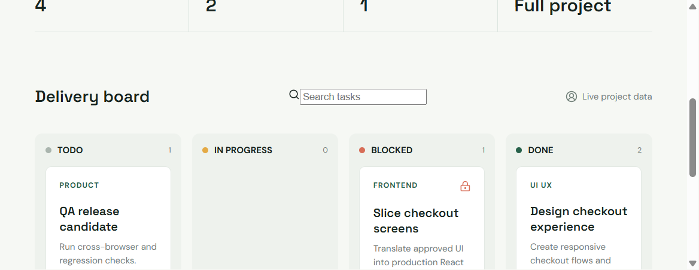
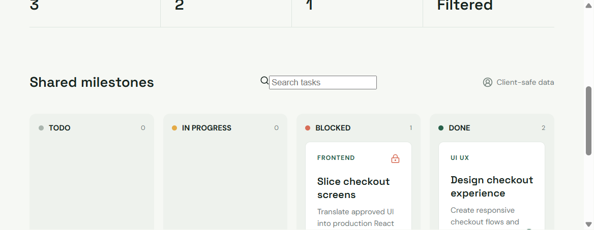

# NodeWave Delivery Web

Next.js 16 App Router interface for the Delivery OS assessment.

## Local setup

Copy `.env.local.example` to `.env.local`, run `npm install`, then `npm run dev`.
The seeded role selector supports PM, UI/UX, Frontend, and Client Guest accounts. Password for all demo accounts is `password`.

## Assessment Evidence

### Auth

### PM Task Board

### Blocked Frontend Task

### Client Guest View

The short demo recording follows [RECORDING_SCRIPT.md](RECORDING_SCRIPT.md).
